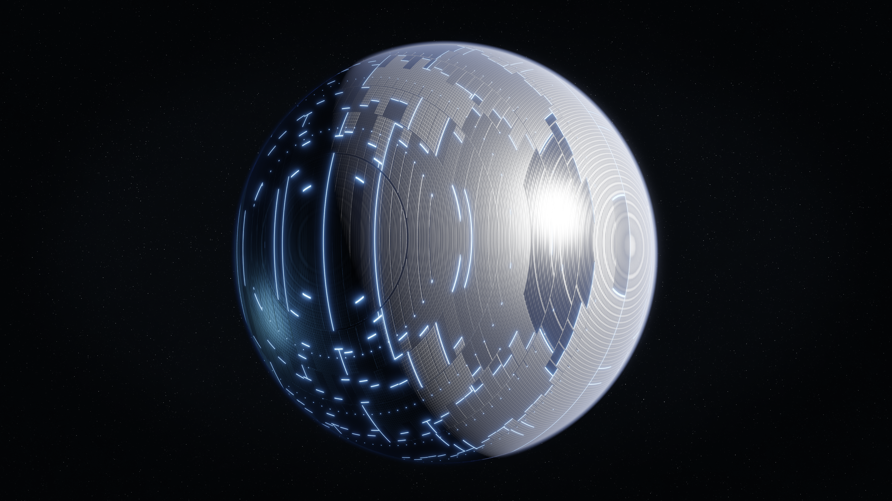
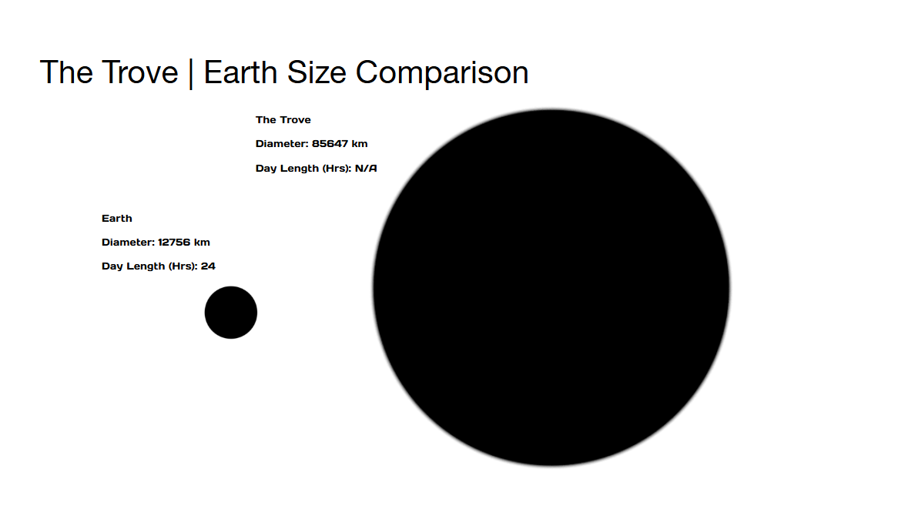

# The Trove

## Description
The Trove is a [Curator](../Factions/Curators/curators.md) Shield world constructed in the intergalactic void. Travelling to the Trove is a huge undertaking, one of the few times the Curators would travel via deeper [VEIL](../Lore/Tech/VEIL/veil.md) levels than 5. It is possible to reach the Trove at shallower levels, but is very risky considering the many creatures that exist inside VEIL within the intergalactic void. 

Its exterior shell is comprised of a highly advanced metal alloy, much more advanced than what is present on the Ark. The world is hollow, featuring a surface covering the entire inside of the shell (like an enclosed Dyson sphere). Its power is harnessed from a mini-star in the centre of the sphere which was created by the Curators.

## Construction of the Trove
It is thought the Trove was constructed in the Gemelos Galaxy and moved to a secret place deep within the intergalactic void. The Trove is generally considered to be much more advanced than the Ark, but no one really can definitively say since Curator tech is so far above other species.

## Capabilities of the Trove
The Trove is capable of VEIL travel, although very slow (VEIL 1) maximum depth. It is also capable of travelling into VEIL -2 (The pocket dimensions).

## Size
